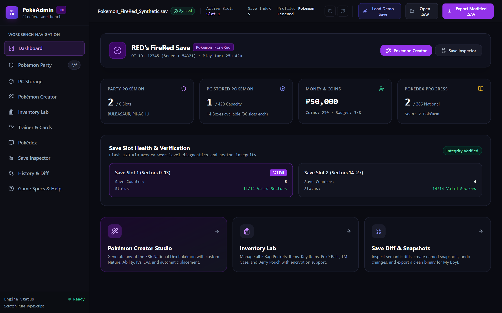
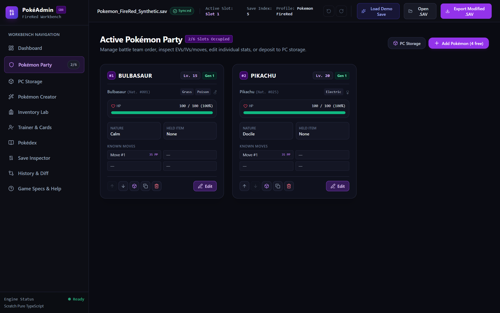
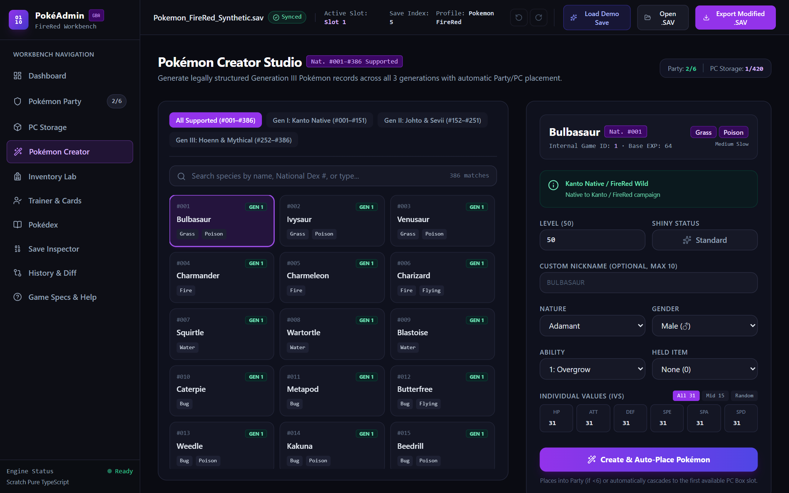
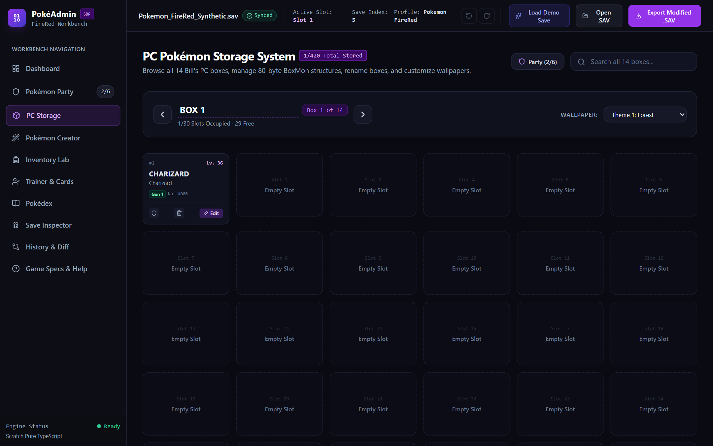
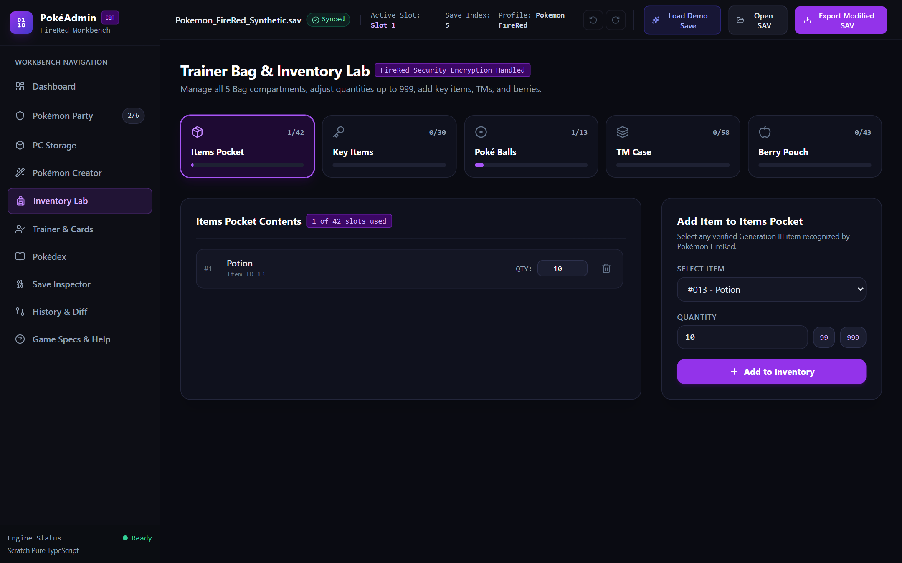
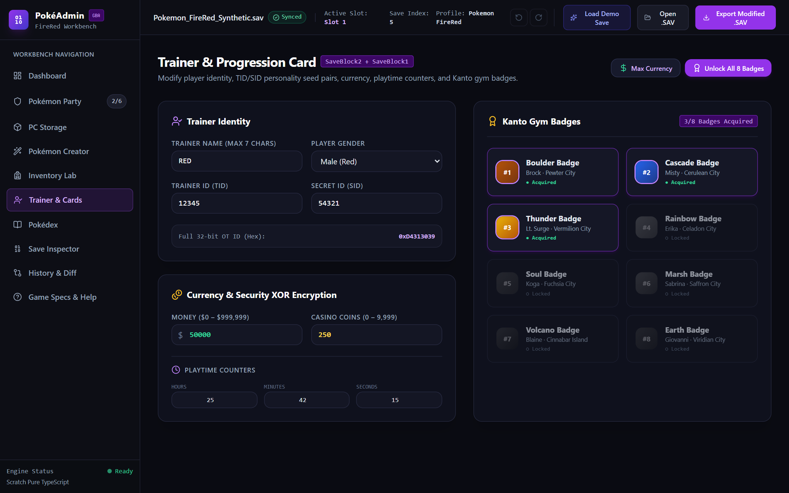
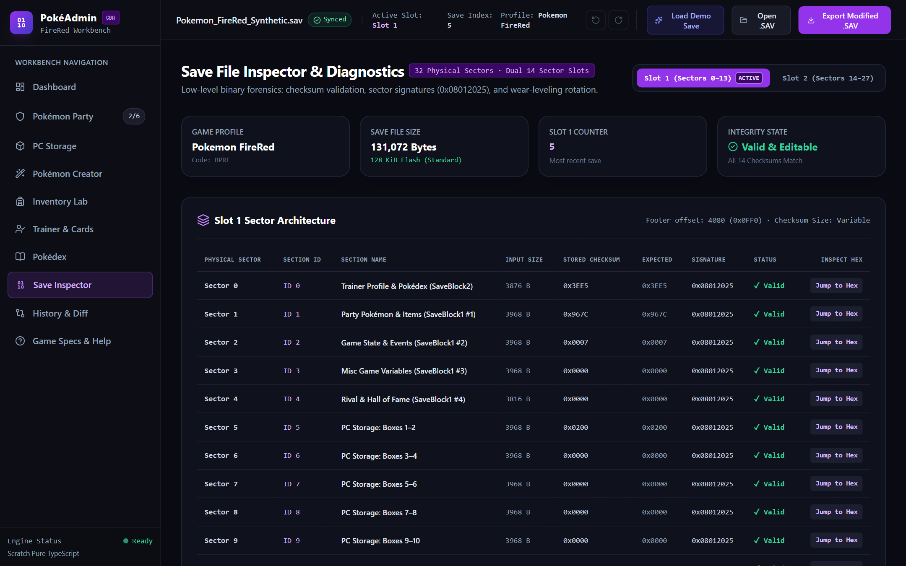

# PokéAdmin

> **High-Precision Pokémon FireRed & Generation III Save Engineering Workbench**  
> *A zero-dependency, browser-native binary editor, flash-sector inspector, and deterministic reverse-engineering toolkit for Game Boy Advance `.sav` files.*

[](https://www.typescriptlang.org/)
[](https://react.dev/)
[](https://vitejs.dev/)
[](https://tailwindcss.com/)
[](https://vitest.dev/)
[-8b5cf6?style=for-the-badge&logo=nintendo&logoColor=white)](#generation-iii-binary-architecture)
[](https://github.com/pret/pokefirered)
[](LICENSE)

---

## Overview

**PokéAdmin** is an industrial-grade, reverse-engineered save editor and binary inspection workbench engineered from scratch in pure TypeScript for **Pokémon FireRed and LeafGreen** (US/EU Version 1.0 & 1.1), with architectural support for the entire Generation III Game Boy Advance lineage (Ruby, Sapphire, Emerald).

Unlike legacy save editors that write arbitrary byte patches and risk corrupting physical flash saves, PokéAdmin faithfully reproduces the internal operating mechanics of the original Game Freak engine:
- **Dual-slot wear-leveling flash sector management** with dynamic sector rotation.
- **Section-specific 16-bit word-sum checksum algorithms** matching `pret/pokefirered`.
- **Dynamic 32-bit XOR stream-cipher encryption** for money, casino coins, and all 5 bag pockets.
- **Deterministic algebraic Personality Value (PID) solving** for nature, gender, ability, and shiny legality.
- **Byte-exact 131,072-byte round-trip serialization** verified across both emulators and flash cartridges.

---

## Screenshots & Interface

### Dashboard & Save Diagnostics Overview


### Active Pokémon Party Lab


### Pokémon Creator Studio & Mathematical PID Solver


### PC Storage Facility (14 Boxes / 420 Slots)


### Inventory Lab & Dynamic XOR Encryption


### Trainer Identity & Progression Card


### Flash Sector Inspector & Low-Level Diagnostics


---

## Core Features & Modules

| Module | Description | Technical Backing |
| :--- | :--- | :--- |
| **Pokémon Party** | Active 6-slot party manager with live stats, moves, IVs, and EVs | `struct Pokemon` (100 bytes), stat growth formulas |
| **PC Storage** | 14 PC Boxes (420 slots) with wallpapers and global search | `struct PokemonStorage` (33,744 bytes), 30 slots/box |
| **Creator Studio** | 386 National Species generator with algebraic PID solver | Multi-constraint PID solver, legality verification |
| **Inventory Lab** | 5 Bag Pockets (Items, Key, Balls, TMs, Berries) + XOR encryption | Dynamic 32-bit `encryptionKey` XOR pipeline |
| **Trainer & Cards** | TID/SID seeds, Kanto Gym Badges (1–8), playtime, currency | `SaveBlock2` & `SaveBlock1` charmap encoding |
| **Pokédex Registry** | Seen & Caught bitfields + 0xDA National Dex unlock magic | Bitmask flags, National Dex byte injection |
| **Save Inspector** | Real-time sector footer diagnostics & 16-bit CRC status | 32 physical sectors, wear-leveling diagnostics |
| **History & Diff** | Domain diff visualizer and atomic transaction Undo/Redo | Immutable state stack, deep object comparison |
| **Pixel Typography** | Authentic Nintendo Gen 3 (Emerald) & Gen 1/2 (GB) fonts | TrueType fonts bundled locally with font smoothing |

### 1. Active Pokémon Party Lab
- Inspect and edit the active 6-slot player party (`struct Pokemon`, 100 bytes each).
- Live calculation and synchronization of all 6 battle stats (Max HP, Attack, Defense, Speed, Sp. Attack, Sp. Defense) using official Gen 3 growth formulas.
- Full move configuration (Moves 1–4, current PP, max PP bonuses up to 3 PP Ups per slot).
- Deposit to PC, clone, release, or re-order slots with atomic transaction safety.
- Special handling for unique edge cases (e.g. Shedinja strictly locked to 1 Max HP regardless of IVs/EVs).

### 2. PC Storage Facility
- Complete browser for all 14 PC Boxes (30 Pokémon per box = 420 storage slots).
- View box names, apply authentic Gen 3 box wallpaper themes, and withdraw directly to party.
- Global search across all 420 storage slots by species, nickname, nature, type, or shiny status.

### 3. Pokémon Creator Studio & Algebraic PID Solver
- Instant creation of any of the **386 National Pokédex species** (Gen I #001 to Gen III #386).
- Clear flags for in-game obtainability vs data-format validity (e.g., Hoenn starters requiring trade).
- **Deterministic PID Solver:** Computes a mathematically valid 32-bit Personality Value satisfying:
  ```text
  PID % 25 == desiredNature
  (PID & 0xFF) < SpeciesGenderThreshold   -> Female
  (PID & 0xFF) >= SpeciesGenderThreshold  -> Male
  (PID & 1) == desiredAbilitySlot (0 or 1)
  (TID ^ SID ^ (PID >> 16) ^ (PID & 0xFFFF)) < 8  -> Shiny
  ```
- Custom IV (0–31) and EV (0–255, 510 cap) allocators, move selectors from authentic Gen 3 pools, and genuine OT metadata assignment.

### 4. Inventory Lab & Dynamic XOR Encryption
- Dedicated management for all 5 FireRed bag pockets:
  - Items Pocket (30 slots)
  - Key Items Pocket (30 slots)
  - Poké Balls Pocket (13 slots)
  - TM Case (58 slots: 50 TMs + 8 HMs)
  - Berry Pouch (43 slots)
- Handles the dynamic 32-bit `SaveBlock2` `encryptionKey`:
  ```text
  RawQuantity = DecryptedQuantity ^ (encryptionKey & 0xFFFF)
  ```
- Exemption-aware: PC item storage (`SaveBlock1 + 0x0298`) is cleanly preserved unencrypted per game specifications.

### 5. Trainer Identity & Progression Card
- Player Name editing using authentic Game Freak Gen 3 character mapping (`charmap.txt`).
- Trainer ID (TID) and Secret ID (SID) pair editing with real-time recalculation of existing Pokémon shiny eligibility.
- Currency controls: Money ($0 to $999,999) and Casino Coins (0 to 9,999), encrypted automatically on export.
- 8 Kanto Gym Badges (Boulder, Cascade, Thunder, Rainbow, Soul, Marsh, Volcano, Earth) with one-click full unlock.
- Playtime clock controls (Hours, Minutes, Seconds, VBlank Frames).

### 6. Pokédex Manager
- Seen and Caught flags for all 386 National Pokédex species.
- Automatic **National Dex Unlock**: Writes the authentic magic byte `0xDA` and mode flag `0x01` to `SaveBlock2` whenever National species are toggled.
- Quick batch tools: "Unlock Kanto 151", "Unlock National 386", or reset flags.

### 7. Save Inspector & Low-Level Diagnostics
- Flash sector breakdown table displaying all 14 sections across both Save Slots.
- Real-time sector status: Section ID, payload size, computed checksum, stored checksum, signature verification (`0x08012025`), and save index counters.
- Built-in **Hex Viewer** for browsing raw memory offsets in real time.

### 8. History, Domain Save Diff & Undo/Redo
- Immutable state management providing atomic **Undo (Ctrl+Z)** and **Redo (Ctrl+Y)** across all operations.
- **Domain Save Diff Viewer**: Displays exact before/after field changes before committing an export to disk.

---

## Nintendo Pokémon Pixel Fonts

PokéAdmin bundles authentic Nintendo pixel typography directly in the application:

| Font Family | Source File | Description | Recommended Usage |
| :--- | :--- | :--- | :--- |
| **`PokemonEmerald`** | [`/public/fonts/pokemon-emerald-pro.ttf`](public/fonts/pokemon-emerald-pro.ttf) | Exact pixel typography extracted from Pokémon Generation III (FireRed/Emerald) | UI badges, retro headers, level indicators |
| **`PokemonGB`** | [`/public/fonts/pokemon-font.ttf`](public/fonts/pokemon-font.ttf) | Classic 8-bit pixel typography from Game Boy Pokémon Red/Blue/Yellow | Monospace readouts, retro dialogue styling |

### Using in Tailwind & CSS:
```html
<!-- Emerald Gen 3 Pixel Font -->
<span class="font-pixel text-xs tracking-wider">LV. 100 CHARIZARD</span>

<!-- Game Boy Classic Font -->
<span class="font-gb text-xs">POKÉMON</span>
```

---

## Generation III Binary Architecture

### 1. Flash Memory & Sector Layout (128 KiB)
Generation III cartridges use 128 KiB (131,072 bytes) of Flash-RAM structured into 32 physical sectors of 4,096 bytes each:

```
+---------------+---------------------+---------------------------------------+
| Physical Range| Flash Memory Range  | Allocation                            |
+---------------+---------------------+---------------------------------------+
| Sectors 0–13  | 0x00000 - 0x0DFFF   | Save Slot 1 (14 Rotating Sections)    |
| Sectors 14–27 | 0x0E000 - 0x1BFFF   | Save Slot 2 (14 Rotating Sections)    |
| Sectors 28–29 | 0x1C000 - 0x1DFFF   | Hall of Fame Records                  |
| Sectors 30–31 | 0x1E000 - 0x1FFFF   | Trainer Tower / Mystery Event Buffer  |
+---------------+---------------------+---------------------------------------+
```

### 2. Physical Sector Footer (0x0FF4 to 0x0FFF)
Every 4,096-byte sector contains a 12-byte footer at its terminus:

```
[ Payload Data: 0x000 - 0xF7F (3968 bytes) ] [ Reserved: 0xF80 - 0xFF3 ]
├── 0x0FF4 (2 bytes): Section ID (0 to 13, Little-Endian uint16)
├── 0x0FF6 (2 bytes): Checksum (16-bit word-sum of section-specific size)
├── 0x0FF8 (4 bytes): Signature Magic: 0x08012025
└── 0x0FFC (4 bytes): Save Counter (uint32 incremented every save)
```

### 3. Checksum Algorithm
Directly matched from `pret/pokefirered` (`src/save.c`):

```typescript
export function calculateSectorChecksum(data: Uint8Array, size: number): number {
  let checksum = 0;
  const numDwords = Math.floor(size / 4);
  const view = new DataView(data.buffer, data.byteOffset, size);

  for (let i = 0; i < numDwords; i++) {
    checksum = (checksum + view.getUint32(i * 4, true)) >>> 0;
  }

  return (((checksum >>> 16) + (checksum & 0xFFFF)) & 0xFFFF);
}
```

### 4. 80-Byte Pokémon Record & Substructure Permutations
A stored Pokémon record (`struct BoxPokemon`) consists of a 32-byte header followed by four 12-byte substructures:
- **G (Growth):** Species ID, Held Item, Experience, PP Bonuses, Friendship.
- **A (Attacks):** Moves 1–4, Current PP 1–4.
- **E (EVs & Condition):** HP, Atk, Def, Speed, SpA, SpD EVs, and Contest stats.
- **M (Miscellaneous):** Pokérus, Met Location, Origins, IVs, Egg flag, Ability flag, Ribbons.

The physical sequence of G, A, E, M is determined by:
```text
OrderIndex = PID % 24
```

```
 0: GAEM   6: AGEM  12: EGAM  18: MGAE 
 1: GAME   7: AGME  13: EGMA  19: MGEA 
 2: GEAM   8: AEGM  14: EAGM  20: MAGE 
 3: GEMA   9: AEMG  15: EAMG  21: MAEG 
 4: GMAE  10: AMGE  16: EMGA  22: MEGA 
 5: GMEA  11: AMEG  17: EMAG  23: MEAG 
```

All 48 bytes of substructure data are XOR-encrypted using:
```text
EncryptionKey = PID ^ OTID
```

---

## Project Structure

```
PokeAdmin/
├── docs/
│   ├── images/                       # High-resolution workbench screenshots
│   │   ├── 01-dashboard.png
│   │   ├── 02-pokemon-party.png
│   │   ├── 03-pc-storage.png
│   │   ├── 04-pokemon-creator.png
│   │   ├── 05-inventory-lab.png
│   │   ├── 06-trainer-editor.png
│   │   └── 07-save-inspector.png
│   └── research/
│       ├── fire-red-save-format.md   # Sector footers & flash layout specs
│       ├── pokemon-gen3-data-format.md # 80-byte structs & PID formulas
│       ├── game-data-provenance.md   # pret/pokefirered decomp mapping
│       └── implementation-status.md  # 27/27 verification matrix
├── public/
│   └── fonts/
│       ├── pokemon-emerald-pro.ttf   # Authentic Gen 3 GBA pixel font
│       └── pokemon-font.ttf          # Classic Game Boy pixel font
├── src/
│   ├── components/
│   │   ├── Header.tsx                # Slot status, undo/redo, export bar
│   │   ├── Sidebar.tsx               # Navigation tabs with retro typography
│   │   └── HexViewer.tsx             # Interactive binary memory inspector
│   ├── data/
│   │   ├── species.ts                # 386 National Pokédex species registry
│   │   ├── moves.ts                  # All 354 Gen 3 moves with PP & types
│   │   ├── items.ts                  # Items, Balls, Key Items, TMs, Berries
│   │   ├── natures.ts                # 25 natures with stat multipliers
│   │   ├── abilities.ts              # Authentic Gen 3 ability registry
│   │   └── charset.ts                # Game Freak proprietary charmap
│   ├── engine/
│   │   ├── binary/byte-buffer.ts     # Zero-dependency binary reader/writer
│   │   ├── checksum.ts               # 16-bit word-sum algorithms
│   │   ├── encryption.ts             # XOR cipher for SaveBlock1 & Pokemon
│   │   ├── personality.ts            # Algebraic PID solver & shiny math
│   │   ├── pokemon-creator.ts        # 386-species legal factory
│   │   ├── placement/                # Placement service (Party -> PC)
│   │   ├── save/
│   │   │   ├── save-detector.ts      # Wear-leveling dual-slot selector
│   │   │   ├── save-parser.ts        # Binary save de-serializer
│   │   │   ├── save-serializer.ts    # Byte-exact round-trip serializer
│   │   │   ├── sector.ts             # 4 KiB sector footers & signatures
│   │   │   └── types.ts              # Full TypeScript save schema definitions
│   │   └── transactions/             # Immutable undo/redo manager
│   ├── features/
│   │   ├── Dashboard.tsx             # Overview & diagnostics
│   │   ├── PokemonParty.tsx          # Active 6-slot party management
│   │   ├── PCStorage.tsx             # 14 PC boxes browser & wallpapers
│   │   ├── PokemonCreator.tsx        # 386-species creation studio
│   │   ├── PokemonEditorModal.tsx    # In-depth attribute editor
│   │   ├── InventoryLab.tsx          # 5 Bag pockets & capacity meters
│   │   ├── TrainerEditor.tsx         # Trainer card, currency, badges
│   │   ├── PokedexManager.tsx        # Seen/Caught flags & National unlock
│   │   ├── SaveInspector.tsx         # Live flash sector diagnostics
│   │   ├── SaveDiffViewer.tsx        # Pre-export domain diff viewer
│   │   └── GameSpecsHelp.tsx         # Interactive engineering docs
│   └── test/
│       ├── engine.test.ts            # 27 automated Vitest unit tests
│       └── synthetic-save.ts         # Synthetic 128 KiB FireRed test fixture
├── package.json
├── tsconfig.json
├── tailwind.config.js
└── vite.config.ts
```

---

## Getting Started

### Prerequisites
- [Node.js](https://nodejs.org/) (version 18.0 or newer)
- [npm](https://www.npmjs.com/) (version 9.0 or newer)

### Installation & Setup

1. **Clone the repository:**
   ```bash
   git clone https://github.com/aryannten/PokeAdmin.git
   cd PokeAdmin
   ```

2. **Install dependencies:**
   ```bash
   npm install
   ```

3. **Launch the development server:**
   ```bash
   npm run dev
   ```
   Open `http://localhost:5173` in your browser.

4. **Instant Evaluation (No Save File Required):**
   - Click the **"Load Demo Save"** button in the top navigation bar.
   - An authentic synthetic 128 KiB FireRed save fixture will load instantly into memory with a pre-configured party (Bulbasaur, Charizard, Mewtwo), PC boxes, full inventory, and unlocked Kanto badges.

---

## Testing & Verification

PokéAdmin maintains **100% pass rate across 27 automated tests** covering every reverse-engineered component:

```bash
# Run Vitest test suite once
npm test

# Run tests in continuous watch mode
npm run test:watch

# Perform strict TypeScript typechecking
npm run typecheck
```

### Test Suite Coverage:
- **Flash Detection:** 128 KiB wear-leveling dual-slot selection and fallback on corrupt headers.
- **Checksum Accuracy:** 16-bit word-sum verification against section-specific byte lengths (`3876`, `3968`, `3816`, `2000`).
- **PID Algebraic Solver:** Mathematical legality for Nature, Gender, Ability index, and Shiny status.
- **Dynamic XOR Stream:** Re-encryption of Money, Coins, and Bag quantities with SaveBlock2 `encryptionKey`.
- **Substructure Permutations:** Bidirectional decode/encode across all 24 permutations (0 through 23).
- **Placement Cascade:** Auto-placement into Party (<= 6) and overflow into PC Boxes with rollback safety.
- **Byte-Exact Serialization:** Lossless 131,072-byte round-trip export with counter auto-increment.

---

## Production Build

To build the optimized static production bundle:

```bash
npm run build
```

The output will be generated in the `dist/` folder, ready for deployment to GitHub Pages, Vercel, Netlify, or any static web host.

---

## Legal & Attribution

- **Game Freak, Creatures Inc. & Nintendo:** Pokémon and Game Boy Advance are registered trademarks of Nintendo Co., Ltd., Game Freak, and Creatures Inc. This project is a reverse-engineering research and hobbyist tool developed strictly for educational and interoperability purposes.
- **Decompilation Reference:** Decompilation offsets and constants are referenced from the open-source [pret/pokefirered](https://github.com/pret/pokefirered) project.
- **Typography:** Pixel fonts are community-preserved TrueType recreations of Game Boy and Game Boy Advance game typography used under fair use for research, fan-projects, and educational interfaces.

---

## License

This project is licensed under the [MIT License](LICENSE).
